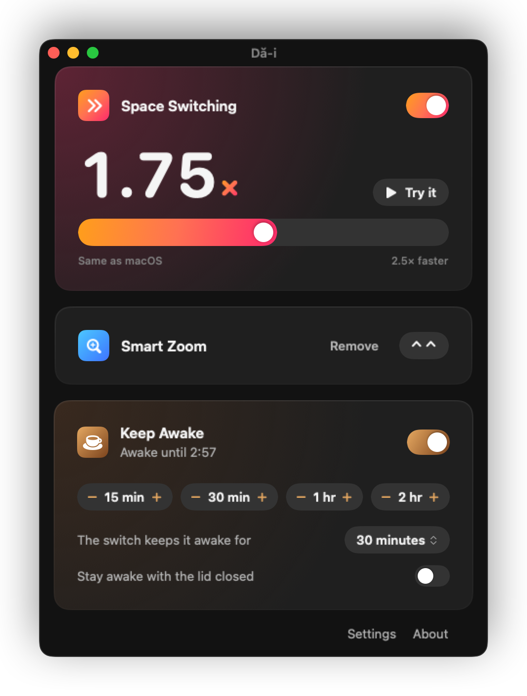
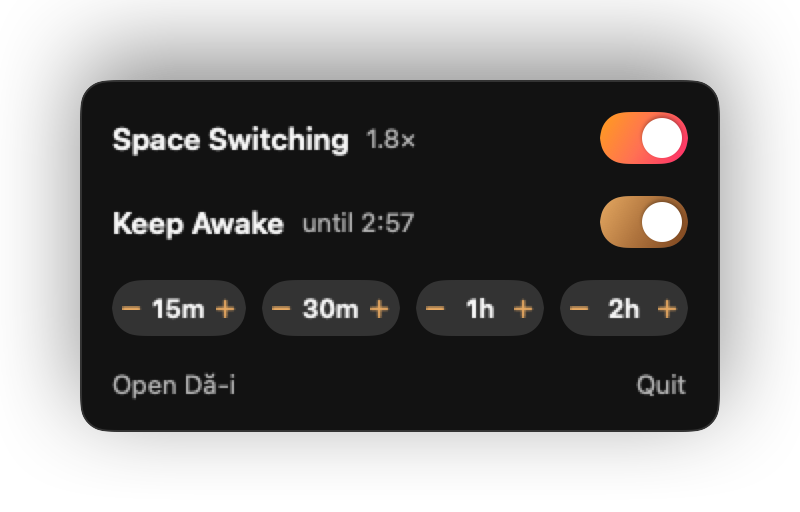
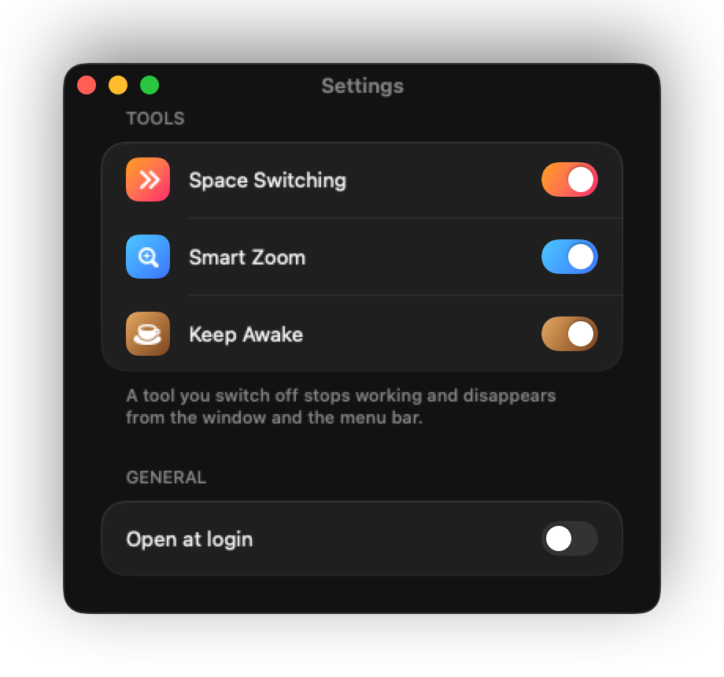

# Dă-i

<p align="center">
  
</p>

<p align="center">
  <strong>Faster Space switching, Smart Zoom from any shortcut, and Keep Awake for macOS.</strong><br>
  <em>Dă-i înainte cu tupeu.</em>
</p>

<p align="center">
  <a href="https://github.com/abaicus/SpaceShift/releases/latest"></a>
  
  <a href="LICENSE"></a>
</p>

<p align="center">
  <a href="https://github.com/abaicus/SpaceShift/releases/download/v3.0/Da-i-3.0.dmg"><strong>Download Dă-i 3.0</strong></a>
  ·
  <a href="https://github.com/abaicus/SpaceShift/releases">All releases</a>
</p>

<p align="center">
  
</p>

Dă-i is a small native menu bar app with three tools. Each one can be switched off in Settings, which stops it and hides it.

## Tools

### Space Switching

Plays the macOS Space animation faster, from the normal speed up to **2.5×**, without removing it.

- Works with `Control + Left/Right Arrow` and three-finger horizontal trackpad swipes.
- **Try it** switches one Space at the speed you picked.
- Does not disable SIP, enable Reduce Motion, or restart the Dock.

### Smart Zoom

The snap-to-content zoom macOS normally reserves for a two-finger double-tap, from a shortcut you choose. It zooms the column, paragraph or image under the pointer, and zooms back out on the next trigger, in apps that support Smart Zoom such as Safari and Preview.

Click **Set Shortcut**, then do one of the following:

- press a key combination that includes `Control`, `Option` or `Command`, or a bare function key;
- double-tap a modifier, such as `Control` twice;
- double-tap any key, such as `Z` twice (the first press is still typed);
- click a middle or side mouse button.

Shortcuts that macOS or apps already use, such as `Command + Q`, are refused. `Esc` cancels recording.

### Keep Awake

Stops the Mac and its display from sleeping.

- The switch keeps it awake for a default you choose: indefinitely, or from 5 minutes to 8 hours.
- Each time chip (**15 min**, **30 min**, **1 hr**, **2 hr**) has a **+** that adds that much to a running session, or starts one of that length, and a **−** that takes it off.
- Optionally stays awake with the lid closed.
- Always starts switched off when Dă-i launches.

## Menu bar and settings

<p align="center">
  
  
</p>

Dă-i keeps running after its window is closed. The menu bar icon opens a small panel with the Space Switching and Keep Awake switches and the Keep Awake time chips. The app shows in the Dock and Command-Tab only while one of its windows is open.

**Settings** (`Command + ,`) switches individual tools off and sets **Open at login**.

## Requirements

- Apple silicon Mac (`arm64`)
- macOS 14 Sonoma or newer
- Accessibility permission, for Space Switching and Smart Zoom
- A trackpad is required for synthetic native swipe playback

## Installation

1. Download [`Da-i-3.0.dmg`](https://github.com/abaicus/SpaceShift/releases/download/v3.0/Da-i-3.0.dmg).
2. Open the disk image and drag **Dă-i** to **Applications**.
3. Launch Dă-i.
4. Click **Open Settings…**, then switch Dă-i on under **System Settings → Privacy & Security → Accessibility**, or drag the Dă-i tile shown on that window into the list.

> The release build is ad-hoc signed, not Apple-notarized. If macOS blocks the first launch, open **System Settings → Privacy & Security** and choose **Open Anyway**.

## How Space Switching works

Dă-i listens for the supported keyboard and trackpad input, then supplies the Dock with a synthetic native swipe at the selected velocity. The Dock still renders its own Spaces animation; it simply completes faster.

If another app has Secure Input switched on (a password field, for example), macOS hides key presses from every other app, so `Control + Arrow` runs at normal speed until it is released. Dă-i shows a notice when that happens. Trackpad swipes and mouse buttons are not affected.

## Privacy and security

Dă-i has no networking or analytics code. Intercepted input events are neither logged nor persisted. Accessibility access is used only to recognize the Space-switching input and your Smart Zoom shortcut.

See [SECURITY.md](SECURITY.md) for the release security model and distribution notes.

## Build from source

Requirements: macOS 14+, Swift 6-compatible toolchain, and Apple Command Line Tools.

```sh
git clone https://github.com/abaicus/SpaceShift.git
cd SpaceShift
./scripts/build-app.sh release
open dist/Dă-i.app
```

Create the drag-to-Applications installer:

```sh
./scripts/build-dmg.sh
```

For signing and notarization, see [DEVELOPER.md](DEVELOPER.md).

## Contributing

Focused improvements are welcome. Please read [CONTRIBUTING.md](CONTRIBUTING.md) before submitting a pull request.

## Credits

Dă-i is a fork of [SpaceShift](https://github.com/ReutS1/SpaceShift) by ReutS1.

The synthetic Dock-swipe technique and empirical velocity values are adapted from jurplel's MIT-licensed [InstantSpaceSwitcher](https://github.com/jurplel/InstantSpaceSwitcher). macOS 27 IOHID payload handling is based on the 0BSD-licensed [iss](https://github.com/joshuarli/iss). See [THIRD_PARTY_NOTICES.md](THIRD_PARTY_NOTICES.md) for attribution and bundled third-party licenses.

## License

Dă-i is licensed under the [GNU General Public License v3.0](LICENSE). If you distribute a modified version, you must provide its corresponding source code under the same license.

Copyright © 2026 ReutS1 and contributors. Third-party components remain available under their respective licenses.
